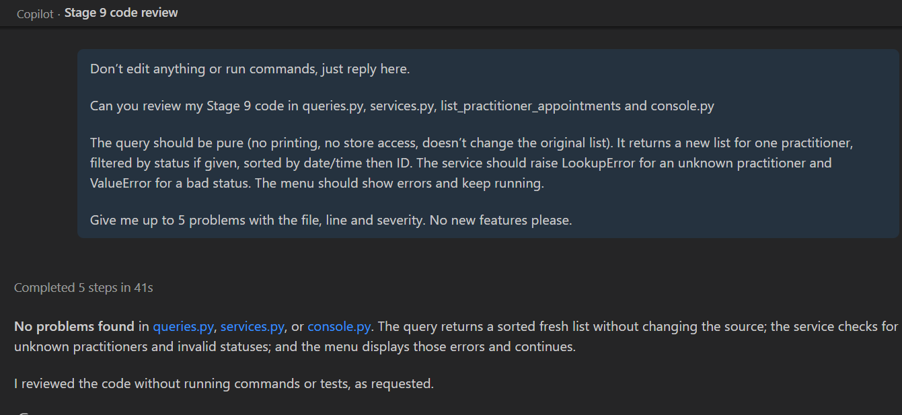

# Stage 9 activities and evidence

Common UG and PG record. All Assignment 3 stage materials are provided from the beginning. Complete this stage only after the previous applicable stage has been integrated, verified and recorded. Use this supplied record in stage09/ in your EXISTING repository. Preserve project/, all earlier tests, records and responses. Do not download another starter or copy staff solutions. Use the Stage 9 handout and Overview/revision 2 baseline. Keep responses concise and link accessible artefacts; do not paste entire logs or private peer ratings.

Group: Group 4, Computer Lab 09 (Friday 08:30–10:30)
Members and responsibilities: Emmanuel Cadman (Emmanuel07-code, UG); Tanveer Uppal (TanveerUppal, UG): Stage 9 implementation, tests, README updates and this record; Tanzir Ahon (Tanzir1718, UG). Design and review were discussed by the whole team in person (see H).
Stage 8 integrated SHA, command, working directory and actual result: 070801a (main, Merge pull request #8). `python -m pytest -q` in project/: 47 passed.

## A. Tutorial activities

### A1 Session state classification

| Information | Required session/domain or transient state? | Requirement or reason |
|---|---|---|
| Patient identity | Required session/domain state | FR-01/FR-02: a registered patient must be found again and linked to appointments. |
| Appointment history | Required session/domain state | FR-07: cancelled appointments are kept and can still be found and listed. |
| Temporary menu choice | Transient | Only decides which operation runs; not part of the domain. |
| Practitioner specialty | Required session/domain state | FR-03: a required practitioner field. |
| Debug print output | Transient | Display only; never stored. |
| Appointment status | Required session/domain state | FR-06/FR-09: drives cancellation rules, conflicts and status filtering. |

What is intentionally lost on exit? All patients, practitioners and appointments. Data lives only in one SmartCareDataStore for the current run and FR-10 restart persistence is retired.

### A2 Interface and domain data plan

Plan before AI. This replaces schema/key design; no database tables are required.

| Function or component | Explicit inputs and types | Outputs | Responsibility and validation | Domain source / existing constraint |
|---|---|---|---|---|
| appointment_sort_key | appointment: Appointment | tuple[datetime, str] | Returns (date_time, appointment_id); no side effects | Appointment.date_time, Appointment.appointment_id properties |
| select_appointments | appointments: list[Appointment], practitioner_id: str, status: AppointmentStatus or None | New list[Appointment] | Pure: filters by practitioner and optional status, sorts with the named key; no I/O, no store, no mutation | appointment.practitioner.practitioner_id, appointment.status |
| Service listing | practitioner_id: str, status: AppointmentStatus or None | New ordered list[Appointment] | Validates ID (blank: ValueError), unknown practitioner: LookupError, non-enum status: ValueError; passes store list to the query | data_store.find_practitioner, data_store.list_appointments |
| Console | Typed text | Printed messages | Reads input, converts date and status text, calls services, prints results or Error: ..., keeps running | parse_date_time, format_appointment, services |

Relate patient ID/name, practitioner ID/name/specialty, and appointment ID/actual participants/date_time/status to the existing contracts: IDs are trimmed, non-blank and case-sensitive (required_text). Names and specialty are required text. An Appointment holds the actual registered Patient and Practitioner objects, a minute-precision local datetime and an AppointmentStatus enum. Listing returns those same stored objects, never copies.

### A3 Responsibility violations

| Conceptual case | Violation | Correct boundary and reason |
|---|---|---|
| Appointment.cancel reads input | Domain doing console I/O | Console reads the ID; the service finds the appointment; cancel() only guards the status change. |
| Service prints/reads the menu | Service doing presentation | Services return objects or raise errors; only console.py prints and reads. |
| Query sorts its source in place | Hidden side effect; not pure | Use sorted() to return a new list and leave the caller's list unchanged. |
| Store prints Appointment saved | Store doing presentation | Store only adds/finds/lists; the console reports success. |

### A4 Sorting comparison

For appointments.sort(key=appointment_sort_key) and result = sorted(appointments, key=appointment_sort_key), predict source order then return value and result identity. Give a meaningful mutation check that is .sort() reorders the source list in place and returns None. sorted() leaves the source order unchanged and returns a new list (result is not appointments) holding the same objects. Check: copy the source (before = list(appointments)), call the query, then assert appointments == before (test_source_list_and_appointments_are_unchanged).

Score-example prediction and explanation of passing the named key: The list is ordered by the key's value, smallest first; equal first values are ordered by the second value. We pass the function name appointment_sort_key (not a call), so sorted() calls it once per item. One named key keeps ordering the same everywhere and can be tested on its own.

### A5 Exit question

Explain cancellation versus deletion, and checks for same-session lookup, all-status listing and SCHEDULED-only exclusion:

Cancellation changes the status to CANCELLED and keeps the same object in the store; deletion would remove history, breaking FR-07. Checks: after cancelling A1, find_appointment('A1') is the same object with status CANCELLED; the default listing still includes A1; the SCHEDULED filter excludes it (test_listing_default_includes_cancelled_history, test_listing_with_status_filter).

## B. Human design and contracts

| Requirement | Input / session data | Operation and responsible component | Expected result or error | Test / evidence |
|---|---|---|---|---|
| QRY-01 practitioner filter | D1 and D2 appointments | select_appointments (queries.py) | Only D1's appointments | test_default_returns_all_statuses_for_one_practitioner_in_order |
| QRY-02 status filter | Each AppointmentStatus | select_appointments | Only matching status | test_status_filter (3 cases) |
| QRY-03 ordering | Equal and different times | appointment_sort_key | Date/time, then ID | test_named_key_orders_by_time_then_id |
| QRY-04 empty result | No match / empty list | select_appointments | New empty list | test_no_match_or_empty_source_returns_a_new_empty_list |
| FP-01 purity | Unsorted source | select_appointments | Source order and fields unchanged | test_source_list_and_appointments_are_unchanged |
| FP-02 named key | Same key with sorted() | appointment_sort_key | Same order | test_named_key_orders_by_time_then_id |
| FP-03 new list, same objects | Repeated / already-sorted calls | select_appointments | New equal lists, same objects | test_result_is_a_fresh_list_of_the_same_objects |
| FR-09 / FR-07 listing | Cancelled + scheduled | AppointmentService.list_practitioner_appointments | All statuses by default, ordered | test_listing_default_includes_cancelled_history |
| FR-09 errors | Unknown ID / text status / blank ID | Service listing | LookupError / ValueError / ValueError | test_listing_unknown_practitioner_raises_lookup_error, test_listing_invalid_status_or_blank_id_raises_value_error |
| UI-01 / UI-02 | Typed menu input | run_menu (console.py) | Every option works; errors shown, menu continues | D |

## C. Implementation and query verification

| Requirement / test ID | Code location | Case and meaningful assertion | Actual result | Evidence link |
|---|---|---|---|---|
| QRY-01, QRY-03 | queries.py select_appointments | D1 only; equal 09:00 times ordered A2 then A3 | Passed | tests/test_queries.py |
| QRY-02, FR-07 | queries.py | SCHEDULED/CANCELLED/COMPLETED each return one ID | Passed | tests/test_queries.py::test_status_filter |
| QRY-03, FP-02 | queries.py appointment_sort_key | Key == (datetime, 'A3'); reused with sorted() | Passed | tests/test_queries.py |
| QRY-04, FP-03 | queries.py | No match / empty source give a new [] | Passed | tests/test_queries.py |
| FP-01 | queries.py | Source order, objects and status unchanged | Passed | tests/test_queries.py |
| FP-03 | queries.py | Repeated calls equal but not the same list; same objects | Passed | tests/test_queries.py |
| FR-09, FR-07 | services.py list_practitioner_appointments | Cancelled A1 still listed, ordered before A2 | Passed | tests/test_services.py |
| FR-09 | services.py | Known with none: []; unknown: LookupError; text status / blank ID: ValueError | Passed | tests/test_services.py |
| Full suite | project/ | `python -m pytest -q` | 63 passed (47 earlier + 13 query/listing + 3 workflow) | screenshot (kept by the team) |

## D. Integrated console and workflow evidence

| Scenario / acceptance ID | Reproducible inputs / artefact | Expected result | Observed result and state check | Evidence link |
|---|---|---|---|---|
| UI-01 full menu workflow | `python main.py --interactive` in project/: register P1, D1, D2; book A1 (D1, 2026-10-01 09:00); same D1 time; A2 with D2 same time; cancel A1; find A1; list D1 (blank); list D1 scheduled; book A3 in freed slot; list D1; 0 | Conflict rejected; D2 allowed; A1 kept as cancelled; lists ordered; freed slot booked; normal exit | As expected. Final D1 list: A1 cancelled, A3 scheduled, `2 appointment(s) found.` | screenshot (kept by the team) |
| UI-02 invalid-input recovery | Duplicate P1, blank patient ID, unknown D9, `not a date`, `2026-02-30 09:00`, status `pending`, repeated cancel of A1, choice `99` | `Error: ...` or `Unknown choice...` and the menu returns | Each error shown; next action (e.g. find P1, book A3) succeeded; A1 stayed CANCELLED | screenshot (kept by the team) |
| Automated service workflow | tests/test_workflows.py (3 tests: full booking workflow; rejected requests keep stored records; repeated cancel and invalid status) plus the listing tests in tests/test_services.py | Book, conflict rejected with state unchanged, other practitioner allowed, cancel keeps history, filter, freed slot booked; duplicate/unknown IDs rejected without changing records | `python -m pytest -q` in project/: 63 passed | tests/test_workflows.py |

Include registration/find, booking, conflict rejection, different-practitioner booking, cancellation, retrieval, listing/filtering, freed slot and exit; duplicate/unknown/blank IDs, malformed/impossible date, invalid status, unknown choice and repeated cancellation. Identify before/after state and subsequent successful action.

## E. GitHub Copilot review and human decisions

Human design completed before AI: Check section B
Actual prompt/context supplied: GitHub Copilot Chat in VS Code, 9 Nov 2026 (after commit 92841cf). Prompt:
> Don't edit anything or run commands, just reply here.
> Can you review my Stage 9 code in queries.py, services.py, list_practitioner_appointments and console.py
> The query should be pure (no printing, no store access, doesn't change the original list). It returns a new list for one practitioner, filtered by status if given, sorted by date/time then ID. The service should raise LookupError for an unknown practitioner and ValueError for a bad status. The menu should show errors and keep running.
> Give me up to 5 problems with the file, line and severity. No new features please.

Response: "No problems found in queries.py, services.py, or console.py." It said the query returns a sorted fresh list without changing the source, the service checks unknown practitioners and invalid statuses, and the menu shows errors and continues. It reviewed without running tests.

| AI finding | Code/test evidence | Severity | Accept/Modify/Reject and reason | Change or no change | Actual verification |
|---|---|---|---|---|---|
| No problems found | Matches our tests and the manual console run (D) | None | Accept with caution: Copilot did not run anything, so its "no problems" is not proof on its own | No change | Full suite 60 passed, tests only fail when tie-break or purity is broken on purpose (C) |

AI-use statement: Assistance in formatting and structuring along with further understanding concepts leading to better clearity of implemented topics was taken from copilot. All judgements and revisions are done by us.

Responsibility check: explain how domain invariants, shared-store collections, service coordination, pure queries and console effects remain separate: Appointment.cancel() still guards status; the store only adds/finds/lists, the service validates and coordinates; the query only filters and sorts its inputs; only console.py reads input and prints.

## F. Required reflections

1. Which integration concern was architectural rather than a filtering/sorting detail? Where each check belongs: text-to-status conversion in the console, unknown/invalid checks in the service, and filtering in a pure query that never touches the store.
2. Which Copilot suggestion did you reject as over-engineering, and why? None. Copilot made no suggestions in this review, so nothing was rejected. We just kept the simple design.
3. How did you prove cancelled appointments remain retrievable and listable in the same session? test_listing_default_includes_cancelled_history cancels A1 and asserts it is still listed with status CANCELLED and the console run found A1 as cancelled and listed it with A3.

## G. Ten formative answers

1. What makes select_appointments pure, and what side effect breaks purity? It depends only on its inputs and returns a new list. Printing, reading input, using the store or sorting the source in place would break purity.
2. Which explicit inputs are needed, and why avoid a global store? The appointment list, practitioner ID and optional status. Passing them in keeps the function testable and reusable.
3. How can a new list reuse Appointment objects safely? The list is new, so reordering it does not affect the store, the objects are shared and only change through domain methods like cancel().
4. Why use a named key, and what breaks equal-time ties? One tested ordering rule used everywhere. The appointment ID breaks ties.
5. How do default and explicit status filters differ? Default (None) returns all statuses, including cancelled history whereas an explicit status returns only that status.
6. How do empty, unknown practitioner and invalid filter cases differ? Empty: known practitioner, no matches, returns []. Unknown: LookupError. Invalid status or blank ID: ValueError.
7. Which console errors recover, and how is unchanged state checked? ValueError and LookupError are(bad date, status, ID, duplicate, conflict, repeated cancel) plus unknown menu choices. The next action works and the earlier records are unchanged (e.g. A1 still CANCELLED).
8. What is data integrity for registered participants, conflicts and history? Appointments link the actual registered objects, a practitioner has at most one SCHEDULED appointment per exact time, and cancelled history is never deleted.
9. What is Copilot's review role, and who verifies findings? Copilot gives possible findings but the team checks them against code and tests and decides.
10. How do pure functions and OOP responsibilities work together? Objects protect their own rules and the service coordinates but the pure query just filters and sorts the objects it is given.

## H. Review, completion and common handover

Issues and bounded branches: Branch feature/stage9-queries (commits 3f03c16, 31a9aae, 3f6c5ec, ae998de, 92841cf), one task per commit.
PR/diff and another-member human reviewer: Stage 9 PR #9 merged directly as 5b31a55. Merging directly was approved by our tutor; the team discussed and reviewed the changes together in person before upload.
Review responses and Copilot comparison: Team review and Copilot both found no problems; tests confirm (E).
Integrated common Stage 9 SHA: 5b31a55 (main, Merge pull request #9)
<<<<<<< HEAD
Full regression command, working directory, actual count/result and evidence: python -m pytest -q in project/: 60 passed. screenshot (kept by the team)
=======
Full regression command, working directory, actual count/result and evidence: `python -m pytest -q` in project/: 63 passed (60 before tests/test_workflows.py was added). screenshot (kept by the team)
>>>>>>> origin/main
README run instructions and scope/limitations: [README.md](../README.md), [project/README.md](../project/README.md)
Unresolved issues and support/action: None.
UG common candidate / PG future branch plan: UG-only group; 5b31a55 is our common candidate for Stage 12. Stages 10/11 not applicable.

- [x] Query contracts, purity, new lists and named-key ordering verified.
- [x] Service empty/unknown/invalid cases and cancellation history verified.
- [x] Every console command and invalid-input recovery demonstrated.
- [x] Query and workflow tests plus all previous tests pass; actual evidence linked.
- [x] Human design, Copilot critique, review and integration recorded honestly.
- [x] Reflections and ten formative responses completed.
- [x] README updated; earlier code/tests/records preserved.
- [x] Common SHA protected for UG Stage 12; PG Stage 10/11 work deferred until approved.

No persistence, rescheduling or assurance implementation is part of Stage 9. UG: 6→7→8→9→12. PG: 6→7→8→9→10→11→12. Mixed groups keep one repository and protect the common candidate.